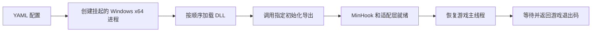

# crossover-steam-recordfix

**YAML preload 启动器 + MinHook 修复 DLL**，用于让 CrossOver/D3DMetal 下的 Windows Steam 游戏使用游戏内录制。目标程序、参数、工作目录、预加载 DLL 和 Steam App ID 都由配置决定，代码不绑定 MHW。

目前实际游戏验证对象是 **《怪物猎人：世界》DX12、CrossOver 26.3、D3DMetal 4.0b1、Apple Silicon**。可配置多个游戏，不代表已验证所有游戏。

## 修复思路

调查中发现三个相互独立的问题：

1. **Steam 无法挂接原生 COM 方法。** D3DMetal 的部分虚表方法在 Mach-O 模块中；macOS 将页面标为可执行，Wine 的内存接口却返回 `MEM_FREE/PAGE_NOACCESS`。Steam 的 `VirtualProtect` 因错误87 / `STATUS_INVALID_PARAMETER` 失败。
2. **NV12 捕获纹理导致 Metal 断言。** Steam DX12 捕获请求 `NV12 + ALLOW_RENDER_TARGET`，当前 D3DMetal 报 `invalid pixelFormat (0)`。
3. **硬件编码初始化调用缺失接口。** 当前 Wine 的 `GDI32!D3DKMTSetProcessSchedulingPriorityClass` 未实现。

对应处理：

- MinHook 在内存中挂接 DXGI factory 导出，并挂接原 DXGI 模块所属的 PE factory 方法入口。保留原 COM 对象，复制虚表，借助 ABI 透明 PE 跳板适配原生方法，使 Steam 的内存保护操作和模块归属检查都能通过。
- 仅对来自 Steam Overlay 的 NV12 render-target 分配返回 `E_INVALIDARG`，让 Steam 自行回退到 RGB 捕获和 CPU 色彩转换。
- 在 Steam 设置中关闭游戏录制的硬件编码，使用 x264；不伪造 GPU 调度接口的实现。

早期实现是替换瓶子内的 `system32/dxgi.dll` 为代理。当前实现**不替换系统 DLL，也不改写磁盘上的二进制指令**。MinHook 本身仍是运行时内存 detour。不能直接对 Mach-O 地址使用 MinHook：那样仍会遇到同一个 Wine 内存保护问题，故保留虚表适配层。

## 启动流程



初始化不在 `DllMain` 的 loader lock 中执行。失败时终止本次刚创建的挂起进程，不让游戏在半初始化状态下运行。启动器不依赖 Stracker、QuestLoader 或游戏插件目录。启动器使用 Windows GUI 子系统，不弹出控制台；配置、创建进程或注入失败时，先清理本次创建的子进程，再用 MessageBox 显示错误并退出。游戏正常退出时保留其退出码，不额外弹窗。自动化检查可设置 `RECORDFIX_NO_ERROR_DIALOG=1` 抑制错误框，仍保留 stderr 和退出码。

## 构建

### Windows / MSVC

使用 Visual Studio C++、Windows SDK、CMake、Python 3，在 x64 开发者终端执行：

```powershell
cmake -S . -B build -A x64
cmake --build build --config Release
build\Release\recordfix_smoke.exe "$PWD\build\Release\steam_recordfix.dll"
python tests/run_launcher_tests.py build/Release
```

MSVC 使用 MASM 生成 PE 跳板。Windows CI 构建并运行以上测试；本机交叉编译结果与 CI 结果分别记录。

### macOS / Zig

```sh
brew install zig python
python3 tools/build_zig.py
```

输出位于 `build/`：

- `recordfix_preload.exe`：通用 YAML 启动器；
- `steam_recordfix.dll`：MinHook 修复模块；
- `recordfix_smoke.exe` / `recordfix_launch_target.exe`：验证程序。

Zig 路径使用 GNU C 工具链；接口只依赖 Windows C/COM ABI。已固定 MinHook 和 LibYAML 源码，无需在构建时联网下载。

## YAML 配置

参考 [`examples/mhw.yaml`](examples/mhw.yaml) 和 [`examples/game.yaml`](examples/game.yaml)。

```yaml
executable: 'C:\Games\Example\Game.exe'
working_directory: 'C:\Games\Example'
arguments:
  - '-windowed'
preload:
  - path: '..\build\steam_recordfix.dll'
    initialize: RecordFixInitialize
  - path: 'C:\Program Files (x86)\Steam\GameOverlayRenderer64.dll'
environment:
  SteamAppId: '你的游戏 App ID'
  SteamGameId: '你的游戏 App ID'
  SteamOverlayGameId: '你的游戏 App ID'
injection_timeout_ms: 30000
```

| 字段 | 含义 |
| --- | --- |
| `executable` | 必填，Windows x64 EXE |
| `arguments` | 可选参数列表，支持中文、空参数和引号；不经 shell 执行 |
| `working_directory` | 可选，默认目标 EXE 所在目录 |
| `preload` | 按顺序预加载的 DLL 列表；每项含 `path` 和可选的 `initialize` |
| `initialize` | 可选初始化导出，签名为 `DWORD WINAPI fn(void*)`，参数为 NULL，返回0表示成功 |
| `environment` | 可选环境变量映射，继承启动器原环境后覆盖，仅影响启动器及子进程 |
| `injection_timeout_ms` | 每次远程调用超时，默认30000，范围1000–300000 |

**所有相对路径均相对 YAML 文件目录。** Windows 路径推荐使用 YAML 单引号，避免把反斜杠解释成转义。只接受一个 YAML 文档，拒绝未知字段和重复根字段。上限为64个参数、16个预加载 DLL、32个环境变量。

从 Steam 外启动时，Steam 客户端应先登录运行，配置正确 App ID，并按示例先初始化修复模块、再加载 Steam Overlay。更换游戏只需更换 EXE、参数、工作目录和 App ID；其他启动器、DRM、子进程链和反作弊可能需要额外适配。

## 在 Steam 中点击“开始游戏”

使用 `examples/steam.yaml`，这里只配置修复模块；游戏 EXE、原始参数、工作目录和 App ID 均由 Steam 提供，无需重复填写。

在游戏“属性 → 通用 → 启动选项”中填写（请替换成实际 Windows 路径）：

```text
"C:\recordfix\build\recordfix_preload.exe" --steam "C:\recordfix\examples\steam.yaml" -- %command%
```

`%command%` 是 Steam 提供的游戏命令，必须放在 `--` 后面且不要将整个 `%command%` 额外包成一个字符串。若原来有游戏启动参数，放在 `%command%` 后面。

Steam 模式不允许 YAML 再填写 `executable`、`arguments`、`working_directory`，避免配置覆盖 Steam 的真实启动命令；可选 `environment` 只在需要时显式覆盖继承的变量。通常无需手动预加载 Steam Overlay，Steam 会为游戏配置叠层。

CrossOver 的 `Y:` 通常指向用户目录，例如本地项目的启动选项可使用：

```text
"Y:\IdeaProjects\crossover-steam-recordfix\build\recordfix_preload.exe" --steam "Y:\IdeaProjects\crossover-steam-recordfix\examples\steam.yaml" -- %command%
```

若容器盘符映射不同，请使用该容器实际可访问的路径。删除这条启动选项即可恢复普通 Steam 启动。

## 运行

Windows / CrossOver 的“运行命令”：

```text
recordfix_preload.exe C:\path\to\game.yaml
recordfix_preload.exe --validate C:\path\to\game.yaml
```

macOS 便利入口：

```sh
python3 tools/run_crossover.py --bottle Steam-2 --validate examples/mhw.yaml
python3 tools/run_crossover.py --bottle Steam-2 examples/mhw.yaml
```

运行前：

1. 在 Steam → 设置 → 游戏录制中开启后台录制、**关闭硬件编码**。
2. 若使用过早期系统 DXGI 代理，先恢复原始 DLL，删除该代理添加的按游戏 `dxgi` 覆盖值；保留其他游戏 DLL 覆盖。
3. 更新 YAML 路径，确认目标游戏没有重复运行。

修复 DLL 的 `.log` 写在 DLL 旁边。应看到 `MinHook DXGI export hooks enabled`；Steam 的 `logs/streaming_log.txt` 应出现 `Recording Started` 和 `Game D3D12 RGB + libx264`，媒体目录持续生成分片。仅有 DLL 加载日志不足以证明录制成功。

退出游戏即可撤销该进程的内存钩子；下次不经过 preload 启动器启动，即不加载本补丁。**不要在游戏运行中热卸载 DLL**，已有 COM 对象仍引用它的适配入口。软件编码设置需在 Steam 中自行恢复。

## 验证与限制

详见 [`docs/validation.md`](docs/validation.md)。测试包含真实挂起子进程的注入顺序、主函数前初始化、Unicode/参数传递、相对路径、环境/工作目录、无效配置和初始化失败清理。

- 软件色彩转换和 x264 会增加 CPU 开销。
- 虚表布局覆盖当前 factory7、swapchain4、device14、command queue；记录和静态跳板数量有限。没有声明长时间压力测试或所有图形后端支持。
- 当前只支持直接启动 Windows x64 EXE。游戏再次拉起另一个 EXE 时，补丁不会自动传播；可将最终游戏 EXE 配入 YAML。
- 游戏若必须由其商店启动器创建，App ID 环境变量不一定足以满足要求。不提供反作弊兼容性保证。
- `--validate` 验证配置与目标类型、路径；不执行游戏，不能证明某个游戏的渲染／录制兼容性。

## 依赖与许可证

原创代码采用 MIT。MinHook v1.3.4（`c3fcafdc10146beb5919319d0683e44e3c30d537`）与 LibYAML 0.2.5（`2c891fc7a770e8ba2fec34fc6b545c672beb37e6`）的源码及原许可证保存在 `third_party/`。

仓库不包含 Microsoft SDK、Apple D3DMetal、Steam DLL、游戏文件、用户账号配置或录制视频。
